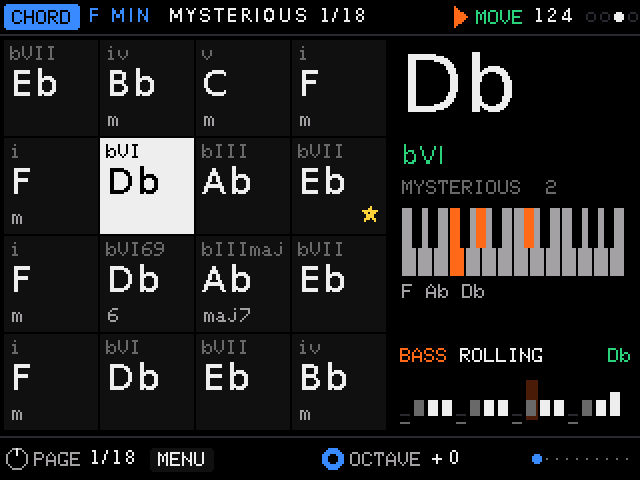
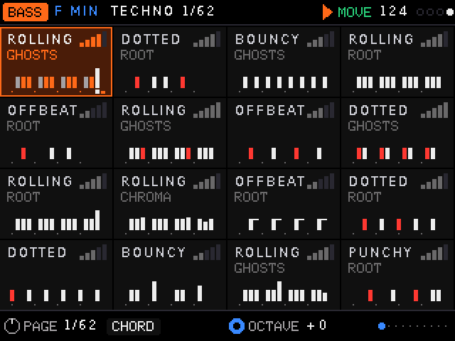

# ChordBox

A DIY chord and bass instrument for the **Ableton Move** (or anything else that takes USB-MIDI). You get 16
pads, two knobs and two screens on an ESP32-S3. It finds chord progressions, plays them instantly, and runs a
bassline that follows your chords, locked to the Move's clock.

 

*Screens rendered by the real UI code on a computer (`tests/host/render.sh`).*

## What it does

- **Chords.** 317 progressions in 24 banks by mood and style (Dark, Mysterious, House, Soul, Jazz…), laid out
  on the pads. Chords are never quantised: they sound the moment a pad goes down. Inversions, chord types,
  voicings, strum, arp, rhythm, echo, repeat, latch and a loop recorder.
- **Bass.** 214 hand-written lines in 16 genres plus generated pages. Lines are written as *roles* (root, fifth,
  octave, approach notes), so they follow the chord you play and stay in key. The screens describe each line by
  what it is (ROLLING, OFFBEAT, ACID, DOTTED…) with its traits, energy and notes.
- **Harmony modes.**
  - HUNT finds the chords of a sample by ear.
  - LISTEN works them out from incoming MIDI.
  - PLAY builds a 16-slot loop.
  - GROW extends it to 8 or 16 bars.
  - MELODY adds a safe line on top.
  - TAKES keeps every version, and PRINT plays the loop once into a Move clip.
- **Key finder.** The pads play single notes; answer FITS or CLASH and it works out the key of what's playing.
- **Phone page.** A web remote over Wi-Fi at `chordbox.local`.

Chords go out on MIDI channel 1, bass on 2, melody on 3.

## Build one

1. Get the parts: [BOM.md](BOM.md).
2. Wire it: [docs/WIRING.md](docs/WIRING.md).
3. Install the [Arduino IDE or `arduino-cli`](https://arduino.github.io/arduino-cli/), the `esp32` board package
   (built with core 3.3.8) and the libraries listed in [THIRD_PARTY.md](THIRD_PARTY.md).
4. Flash it, with the board's COM USB port connected to the computer:

   ```bash
   ./build.sh esp32 flash
   ```

5. On first boot, press the four OLED buttons top to bottom when asked. Then plug the board's **native** USB-C
   port into the Move.

`build.sh` is developed on macOS. On other systems, put `arduino-cli` on your PATH.

**How to play it:** the 2-page [reference](docs/reference.pdf) covers every control, ready to print.

## Wi-Fi and passwords

Wi-Fi is for the phone page. With no saved network, the board opens its own hotspot, `ChordBox`, with the default
password `chordbox-move`. **The default is public, because it's in this repo**, and anyone who joins the hotspot
can use the phone page. Updates over Wi-Fi are off until you set a password. To set your own:

```bash
cp firmware/local_config.example.h firmware/local_config.h
```

Edit it, then flash again. That file is git-ignored. The phone page has no login, so only join networks you trust.

## What's in here

| Path | What |
|---|---|
| `firmware/` | The firmware (C++, Arduino). `config.h` has the pins, `engine.cpp` chords, `bass.cpp` bass, `harm*.cpp` the Harmony modes |
| `midi/` | **672 MIDI files**: every progression in every bank, in C. Regenerate with `tools/export_midi.py` |
| `pico/` | The original Raspberry Pi Pico version (CircuitPython), and the source of the chord data: `progs.txt`, the chord table in `code.py`, `rhythms.txt` |
| `basslines.txt` | The bass lines, one per row, with the format explained at the top |
| `tools/` | `gen_data.py` turns the text data into firmware headers (`build.sh` runs it), plus test and flashing helpers |
| `tests/host/` | Runs the real firmware logic and UI on a computer, no board needed |
| `docs/` | Wiring diagram and tables, the reference sheet |

## Tests

```bash
H=tests/host
SRC="firmware/engine.cpp firmware/bass.cpp firmware/clock.cpp firmware/app.cpp firmware/web.cpp firmware/harm.cpp firmware/harm_theory.cpp firmware/harm_listen.cpp firmware/harm_grow.cpp firmware/harm_melody.cpp"
for t in features perform harmony; do
  sh -c "clang++ -std=c++17 -O1 -w -I $H/shim -I firmware $H/test_$t.cpp $SRC -o /tmp/chordbox_$t" && /tmp/chordbox_$t | tail -1
done
```

## Status

A one-person build, shared as it is. It has been used with one Move, on one set of parts. `firmware/` also
contains Raspberry Pi Pico build paths from before the ESP32 work; this release was only built and tested for the
ESP32-S3. `tests/host/test_engine.cpp` is an old test that no longer links.

## Licence

Code: [MIT](LICENSE). Wiring diagram and docs: [CC BY-SA 4.0](https://creativecommons.org/licenses/by-sa/4.0/).
The chord progressions derive from [free-midi-chords](https://github.com/ldrolez/free-midi-chords) by Ludovic
Drolez (MIT); see [THIRD_PARTY.md](THIRD_PARTY.md). Not affiliated with Ableton.
