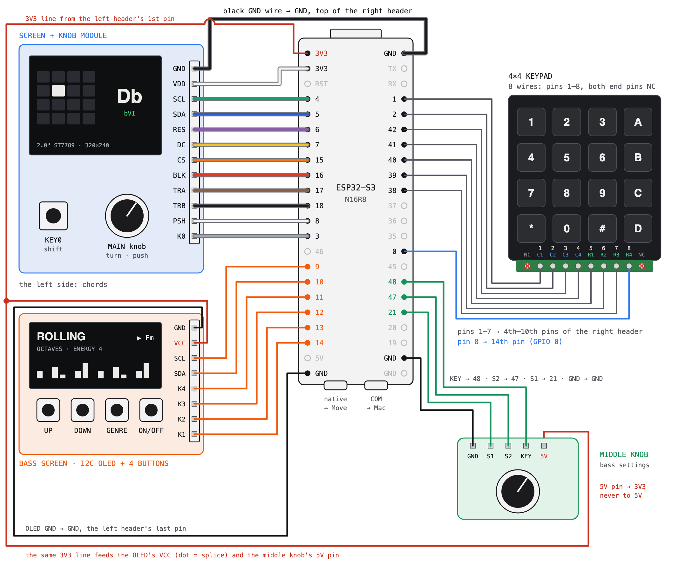

# Wiring

Vector version: [wiring.svg](wiring.svg). The board is shown with its USB ports at the bottom, and header
pins are counted from the top. The pin numbers live in `firmware/config.h`.

> **Power first.** Everything runs on **3.3 V**. The middle knob's pin marked `5V` goes to **3V3**: it only
> powers the pull-ups, and at 5 V it would push 5 volts into the ESP32's inputs. On the screen module, `BLK`
> is the backlight, not power.

## Screen + knob module

| Module pin | ESP32-S3 | Header position |
|---|---|---|
| GND | GND | right, 1st |
| VDD | **3V3** | left, 2nd |
| | RST: leave empty | left, 3rd |
| SCL | GPIO 4 | left, 4th |
| SDA | GPIO 5 | left, 5th |
| RES | GPIO 6 | left, 6th |
| DC | GPIO 7 | left, 7th |
| CS | GPIO 15 | left, 8th |
| BLK | GPIO 16 | left, 9th |
| TRA | GPIO 17 | left, 10th |
| TRB | GPIO 18 | left, 11th |
| PSH | GPIO 8 | left, 12th |
| K0 | GPIO 3 | left, 13th |

## OLED + 4 buttons

| OLED pin | ESP32-S3 | Header position |
|---|---|---|
| GND | GND | left, 22nd (last) |
| VCC | 3V3 | left, 1st (shared) |
| SCL | GPIO 9 | left, 15th |
| SDA | GPIO 10 | left, 16th |
| K4 | GPIO 11 | left, 17th |
| K3 | GPIO 12 | left, 18th |
| K2 | GPIO 13 | left, 19th |
| K1 | GPIO 14 | left, 20th |

Which K pin is which button doesn't matter: on first boot, BUTTON SETUP asks you to press them top to bottom.

## Middle knob

| Knob pin | ESP32-S3 | Header position |
|---|---|---|
| GND | GND | right, 21st |
| S1 | GPIO 21 | right, 18th |
| S2 | GPIO 47 | right, 17th |
| KEY | GPIO 48 | right, 16th |
| 5V | **3V3** | left, 1st (shared) |

The firmware detects this knob at boot. GPIO 48 is also the board's RGB LED data pin, so the LED stays off.

## 4×4 keypad

With the keys facing you, the header reads `NC 1 2 3 4 5 6 7 8 NC`. Pins 1–4 are the columns (C1 = the
`1 4 7 *` column), and pins 5–8 are the rows (R1 = `1 2 3 A`).

| Keypad pin | ESP32-S3 | Header position |
|---|---|---|
| 1 | GPIO 1 | right, 4th |
| 2 | GPIO 2 | right, 5th |
| 3 | GPIO 42 | right, 6th |
| 4 | GPIO 41 | right, 7th |
| 5 | GPIO 40 | right, 8th |
| 6 | GPIO 39 | right, 9th |
| 7 | GPIO 38 | right, 10th |
| 8 | GPIO 0 | right, 14th |

GPIO 0 is also the BOOT button; the keypad doesn't disturb it. If a key plays the wrong pad, MODES → KEYPAD
runs a setup that works out any wiring. Holding MAIN at power-up opens it too.

Two wires share the left header's 1st pin (3V3): twist and solder them into one plug, or use a Y jumper.
